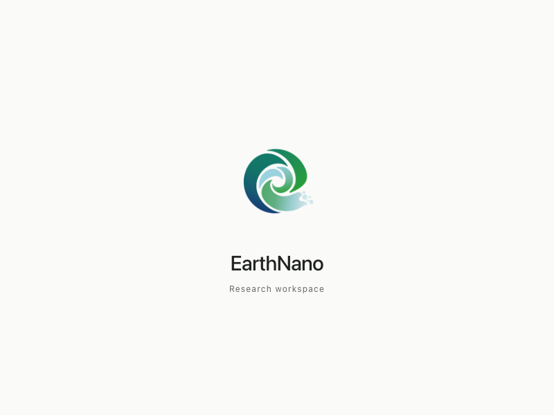
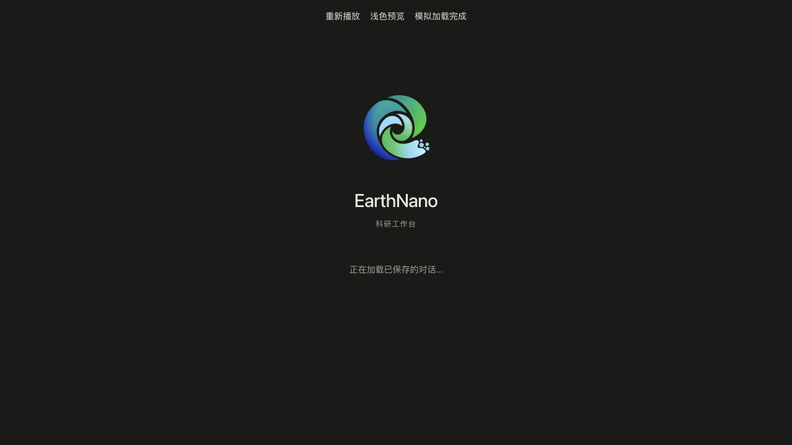
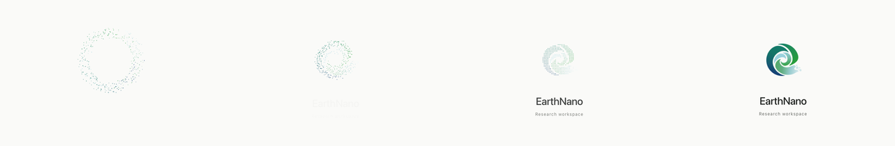
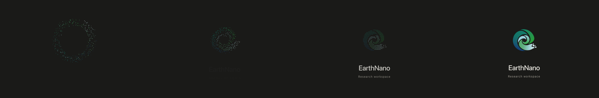

# EarthNano 0.3-Alpha 变更项

本文件记录 0.3-Alpha 的改动项，不表示 0.3 已发布；当前安装包和版本号仍为 0.2.0-alpha.1。

## 启动呈现与图标

- 采用已预览选定的「涡流聚合」：蓝绿粒子汇成 EarthNano 标志，品牌名称随之出现，约 3.2 秒后保持静态。加载完成可随时进入应用，不强制等待动画。
- 聚合轨迹对应新版图标：围绕主体圆心沿圆形轨迹收拢，外侧略晚归位；所有粒子归位后才渐显完整图标。完整图标不再额外旋转或缩放，保证粒子与旋叶在交接时重合。
- 运行时检查、数据库启动、会话加载等现有入口继续共用同一个加载组件；跨入口重挂载延续同一时间线。支持减少动态效果、30 fps 上限、2× DPR 上限、隐藏窗口暂停、卸载清理及无 Canvas 静态回退。
- 图标采用用户于 2026-10-23 暂定的 v27 蓝绿渐变版。保留已确认的正圆主体、右侧圆润尾端、自然留白和外散粒子。`build/earthnano-logo.svg` 是统一矢量源，应用内标志、启动粒子、系统图标和托盘均由它导出。
- 应用内标志保持透明，系统应用图标沿用现有白底外框与平台尺寸。移除旧图专用描边遮罩，避免误套旧轮廓。导出命令与资源清单见 [APP_ICON.md](APP_ICON.md)。

本项不修改科研任务、Notebook、Harness² 执行/优化机制，不包含新模型验证、发布安装包或替换本机应用。

### 确认图标与小尺寸

下方白底仅用于展示，应用内 PNG 的背景和旋叶间隙均为透明。

从左至右为 32、64、128 像素。

### 图标接入验证（2026-10-23）

- 启动动画、启动入口、八语种文案、平台图标和托盘相关测试：10 个文件共 896 项通过，0 跳过；更新旧图基准后，涉及的 2 个图标测试文件 12 项复测通过。
- renderer TypeScript、改动脚本/组件的 ESLint 与 Prettier、`node scripts/earthnano-logo.mjs --check`、`git diff --check` 通过。
- 透明 renderer PNG 与用户确认的 v27 预览逐字节一致。
- 检查五片旋叶和五个粒子完整、无内部透明孔洞，浅色/深色资源和启动粒子同源；检查白底平台母图与 Icon Composer 图层来自同一矢量。
- Windows 应用/托盘图标保留原帧尺寸、32 位深度和数据范围约束；按确认后的新图更新图像摘要。macOS `sips` 可解码导出的 ICNS。
- 实际源码加载组件在浏览器中完成浅色/深色呈现、聚合后静止与卸载检查，无页面错误。自动测试另覆盖 500ms 卸载、减少动态效果和启动入口生命周期。
- 本轮未构建原生安装包或完成完整 Electron 应用验收；Icon Composer 编译与安装后显示仍需原生包检查。

### 启动动画同步验证（2026-10-24）

- 动画算法、加载组件、运行时/数据库启动入口 4 个测试文件共 39 项通过。新增检查覆盖交接前落位、不同 DPR 与图标实际尺寸、窄画布边界和图标尺寸变化。
- renderer TypeScript、改动组件 ESLint / Prettier、`git diff --check` 通过。
- 实际组件在浏览器中采集 0.6、1.5、2.2、3.2 秒帧，验证浅深色、完成后静止及卸载；另检查 320px 窗口、2× DPR 与减少动态效果，无页面错误或横向溢出。
- 本次不修改已确认图标的轮廓、配色或导出资产，也不改变启动完成和取消规则。

从左至右：粒子收拢、形成涡流、对齐图标、完整图标。

