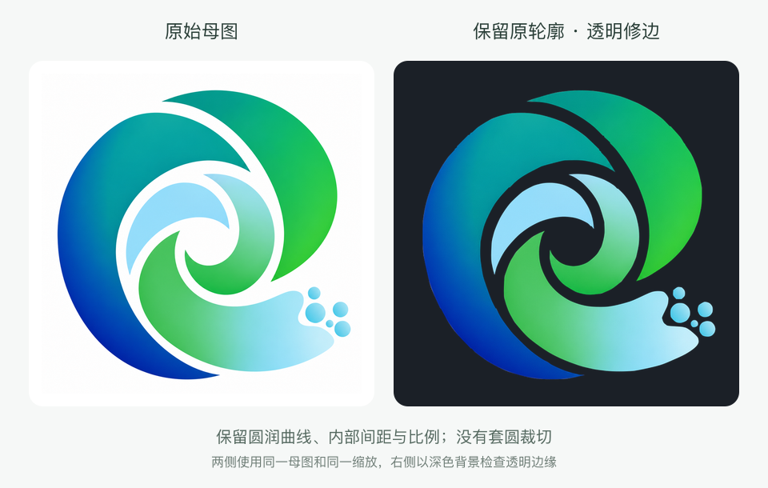

# EarthNano 0.3-Alpha 变更项

本文件记录 0.3-Alpha 的改动项，不表示 0.3 已发布；当前安装包和版本号仍为 0.2.0-alpha.1。

## 启动呈现与图标修正

- 采用已预览选定的「涡流聚合」：蓝绿粒子汇成 EarthNano 标志，品牌名称随之出现，约 3.2 秒后保持静态。加载完成可随时进入应用，不强制等待动画。
- 运行时检查、数据库启动、会话加载等现有入口继续共用同一个加载组件；跨入口重挂载延续同一时间线。支持减少动态效果、30 fps 上限、2× DPR 上限、隐藏窗口暂停、卸载清理及无 Canvas 静态回退。
- 保留现有白底母图 `build/earthnano-icon-master.png` 的圆润曲线、内部留白、渐变和比例。`build/earthnano-logo-mask.svg` 沿原图轮廓描摹，修复透明图的缺口、杂点和白边；正圆仅作为检查参照，没有套圆裁切或重新设计间隔。平台图标继续使用同一母图。
- `node scripts/earthnano-logo.mjs` 导出透明 renderer 图标和启动粒子采样，`--check` 检查两者是否与母图及轮廓一致。母图摘要绑定轮廓，避免改图后误用旧遮罩。原有 `scripts/earthnano-app-icon.mjs` 继续负责平台 PNG/ICO/ICNS/Icon Composer 资源，本次不重新生成平台外框或托盘资源。

验证包括启动动画生命周期、减少动态效果、显示缩放与回退，以及原图形状保持、五片主体/五个粒子完整、无内部透明缺口、背景与留白连通、透明图标和粒子同源。真实启动结果由原 owner 决定，动画不生成虚构进度。

本项不修改科研任务、Notebook、Harness² 执行/优化机制，不包含新模型验证、发布安装包或替换本机应用。

### 原图与修边版

两侧采用同一母图及缩放；右侧以深色背景检查透明区域。被否定的几何重绘版未采用。

### 本轮验证

- 动画、原启动入口、八语种文案、图标资源相关测试：834/834 通过，0 跳过。
- renderer TypeScript 检查、改动文件 ESLint、`node scripts/earthnano-logo.mjs --check`：通过。
- 透明轮廓与原母图的差异全部位于原边缘 2 像素范围内（512px 导出尺寸）；五片主体与五个粒子完整，无内部透明孔洞或游离杂点。平台母图、已发布平台图标及托盘资源未重新生成。
- 实际源码组件在浏览器独立演示中检查了聚合后静止、浅色/深色呈现和 owner 完成后卸载；自动测试另验证在 500ms 时可直接卸载，不等待动画结束。未执行本轮原生安装包构建或完整 Electron 应用验收。

