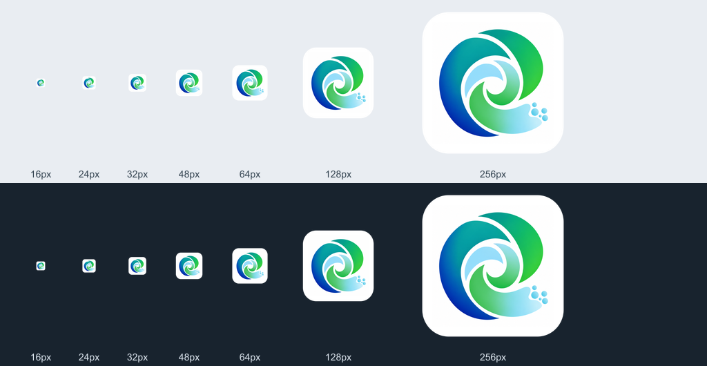

# EarthNano application icon

## Current 0.1-Alpha white icon

The user requested a **white application-icon background**, superseding the earlier transparent
app-icon request. The blue/green spiral and five droplets remain the brand. Transparent renderer
marks and system tray artwork retain their original purpose and are not given white tiles.

Reviewed on 2026-10-20 against Apple's [App icons HIG](https://developer.apple.com/design/human-interface-guidelines/app-icons)
and [Icon Composer documentation](https://developer.apple.com/documentation/xcode/creating-your-app-icon-using-icon-composer).
The master is a 1024 × 1024 unmasked square with an opaque white background, a centered recognizable
subject, generous margins and no text, border, baked lighting or shadows. Apple permits flattened
artwork. The Icon Composer source is also updated with the white background and EarthNano layer;
it must be compiled and inspected on a runner with Apple tools before claiming adaptive-catalog
validation. This host currently has Command Line Tools but no `actool`.

The classic macOS/ICNS export reuses the exact alpha enclosure from the pinned upstream
`aipoch/open-science@9e18c7d3c143a9dba49c7a586ad6cac8096f6dd5:resources/icon.png`.
The background inside the enclosure is white; transparent outer corners are its platform silhouette.
The unmasked master has no predefined corner mask.

- `build/earthnano-icon-master.png`: approved 1024px white artwork.
- `build/earthnano-legacy-icon-mask.png`: original upstream alpha, with white RGB, for classic export.
- `resources/icon.png` / `icon-dark.png`: identical 1024px white app tiles for runtime appearance.
- `build/icon.png`: 512px packaging source; `build/icon.icns`: 16/32/128/256/512pt at 1×/2×.
- `build/icon.ico`, `resources/icon-light.ico`, `resources/icon-dark.ico`: original Windows frame
  inventory, 32-bit DIB plus AND mask for small sizes and PNG for 256px.
- `build/icon.icon`: white Icon Composer source; compilation and actual package use remain separate gates.
- Existing transparent `src/renderer/src/assets/logo*.png` and tray assets are retained.

Reproduce platform formats from the checked-in master and mask with
`node scripts/earthnano-app-icon.mjs`. On macOS this calls `iconutil` without installing tools.
The built-in imagegen output `exec-ff1cba65-899c-4d10-b9bc-75fe0f66440f.png` was proportionally
resampled with white padding into the master. Passing its path once regenerates that master and
extracts the legacy alpha from the fixed upstream Git object. The prompt preserved the ribbons,
palette and five droplets while excluding text, border, premasked corners and artificial effects.

The first regression run failed only the six old transparent-artwork hash comparisons; original
frame dimensions, format, byte ranges, bit depth and tray checks passed. Approved image hashes are
updated after visual review, preserving those assertions. Multi-size light/dark previews use the
actual exported icon. Installer/adaptive-catalog observation remains an Alpha release gate.

## Historical transparent icon provenance

The sections below describe the earlier transparent asset revision. The white app assets above
replace those app-icon exports; renderer and tray marks remain transparent.

The user supplied the blue/green spiral artwork on 2026-10-20 and requested a transparent
application icon. The built-in imagegen tool extracted the mark from the white background;
`resources/icon.png` is the selected 1024 × 1024 RGBA master. Both the exterior background
and the gaps between the ribbons have transparency.

## Application assets

- `resources/icon.png` and `resources/icon-dark.png`: identical full-color transparent
  runtime icons, so theme changes retain the supplied colors.
- `src/renderer/src/assets/logo.png` and `logo-dark.png`: 512 px application logos.
- `build/icon.png`: 512 px packaging source.
- `build/icon.icns`: macOS application and installer-volume icon, exported with macOS
  `iconutil` from 16, 32, 128, 256 and 512 pt PNGs at 1× and 2×.
- `build/icon.ico`, `resources/icon-light.ico` and `resources/icon-dark.ico`: matching
  Windows frames at 16, 20, 24, 30, 32, 36, 40, 48, 60, 64, 72, 80, 96, 128 and 256 px.
- `resources/tray-light.ico` and `tray-dark.ico`: 16, 20, 24, 32, 40, 48, 64 and 256 px.
- `resources/tray.png` and `tray@2x.png`: 32/64 px color tray assets.
- `resources/trayTemplate.png` and `trayTemplate@2x.png`: 18/36 px black alpha silhouettes
  for macOS system tinting.

Resizing and format export used the repository's Sharp dependency; the alpha channel was
preserved. Small Windows frames use 32-bit DIB data plus an AND mask; the 256 px frame
uses PNG. The upstream `build/icon.icon` catalog remains in source but is not selected by
the macOS packaging configuration because it adds an opaque background.

This change updates application icon assets only; product names, application identifiers,
data paths and research execution behavior are unchanged.

## Validation

The existing application-icon, Windows-icon, tray and packaging-configuration suites pass:
4 files, 80 tests. The 1024 px master has four channels; all four corners and the spiral's
center are fully transparent. macOS `sips` successfully decodes the generated ICNS.

The mark was visually inspected at 16, 24, 32, 48, 64, 128 and 432 px on light and dark
backgrounds. The backgrounds in this review image are for inspection only:

No installer was built or installed during this asset change.

## Selected imagegen prompt

> Background extraction ONLY of this exact logo. Make a faithful clean professional cutout
> from the attached original. All white background and all white gaps must be actual 0-alpha
> transparency. Preserve the original subdued blue-teal-green-light cyan colors, smooth
> gradients, precise silhouette, curved ribbon positions and five small dots exactly. Do not
> increase saturation, do not add texture or outlines. Essential quality constraint: SMOOTH
> CLEAN VECTOR-LIKE EDGES, absolutely no speckles, no leftover white flecks or white fringes,
> no green/cyan noise around contours, no drop shadow. Transparent negative space must be
> perfectly clean. The colored shapes are solid opaque with antialiasing only on their very
> edge. Center the same mark on a square transparent canvas with an even 5% safety margin,
> proportional scale. This is a finished app icon asset with no backdrop and no text.
> Output RGBA transparent PNG.

Tool option: `transparent_background: true`. The generated image was proportionally
resampled from 1254 px to 1024 px for the checked-in master.
