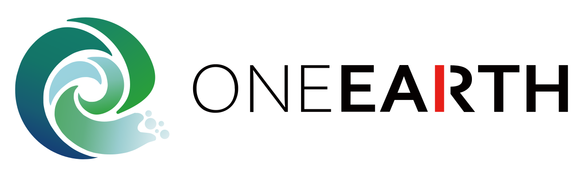
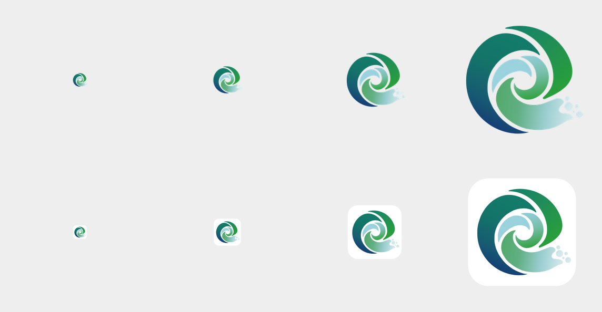

# OneEarth application icon

## OneEarth wordmark and combined brand

On 2026-10-24 the user renamed the application to **OneEarth** and supplied `logo.svg`.
`build/oneearth-wordmark.svg` retains its nine original letter/rectangle shapes, including the
thin ONE, bold EARTH and red R stem. The accepted blue/green vortex is combined with these
letters without changing the mark's geometry or palette.

`node scripts/oneearth-brand.mjs` exports the renderer's light/dark wordmarks and the horizontal
lockup used in the README; `--check` verifies these files. Dark mode changes only the dark letter
fill to a light foreground, retaining the red stem. The startup loader uses the existing vortex
animation above this wordmark. Small application and tray icons retain the standalone vortex.

## Approved 0.3-Alpha artwork

The user accepted the v27 blue/green vortex on 2026-10-23. The checked-in
`build/earthnano-logo.svg` is the editable source for renderer, startup particles, application
icons and tray assets. It retains the approved circular body, rounded right-hand tail, open
internal gaps and five outward droplets. Its canvas, curves and gradients are copied unchanged
from the accepted preview. No extra circle outline is added.

The renderer PNG is byte-identical to the approved 512px transparent preview. The former
white-raster contour mask has been removed: it described the previous artwork and must not be
applied to this vector.

## Export paths

- `node scripts/earthnano-logo.mjs`: exports 512px transparent `logo.png` / `logo-dark.png` and
  the startup particle samples. `--check` detects stale outputs.
- `node scripts/earthnano-app-icon.mjs`: uses the same vector to export the white 1024px platform
  master, runtime PNGs, packaging PNG/ICO, Icon Composer artwork and tray images. On macOS it
  also regenerates ICNS through `iconutil`.

The existing white application tile remains a platform enclosure, separate from the transparent
brand artwork. Classic exports retain the exact alpha from pinned upstream
`aipoch/open-science@9e18c7d3c143a9dba49c7a586ad6cac8096f6dd5:resources/icon.png`, stored in
`build/earthnano-legacy-icon-mask.png`; no replacement enclosure is drawn. Icon Composer retains
its white fill and existing configuration.

| Output                                                                    | Format / sizes                                            |
| ------------------------------------------------------------------------- | --------------------------------------------------------- |
| `build/earthnano-icon-master.png`, `build/icon.icon/Assets/earthnano.png` | 1024px white square, from the approved vector             |
| `resources/icon.png`, `resources/icon-dark.png`                           | Identical 1024px white tiles with existing platform alpha |
| `build/icon.png`                                                          | 512px packaging source                                    |
| `build/icon.icns`                                                         | 16/32/128/256/512pt at 1×/2×                              |
| `build/icon.ico`, `resources/icon-light.ico`, `resources/icon-dark.ico`   | 16/20/24/30/32/36/40/48/60/64/72/80/96/128/256px          |
| `resources/tray-light.ico`, `resources/tray-dark.ico`                     | Transparent 16/20/24/32/40/48/64/256px                    |
| `resources/tray.png`, `resources/tray@2x.png`                             | Transparent 32/64px                                       |
| `resources/trayTemplate.png`, `resources/trayTemplate@2x.png`             | Black alpha silhouettes, 18/36px, tinted by macOS         |

Windows frames retain the upstream layout: 32-bit DIB plus AND mask for small frames, PNG for
256px. The approved image hashes change; dimensions, bit depth and byte-range checks remain.

## Visual review

The top row is the transparent renderer mark; the bottom row is the actual platform tile.
Columns show 32, 64, 128 and 256px exports.

The source is a vector reconstruction of the user-supplied EarthNano artwork, following the
user's review of contours, negative space and blue/green gradients. Earlier raster cleanup
and design drafts remain in Git history, not in the current export pipeline.

See [0.3-Alpha validation](ALPHA_0_3.md) for the current checks. Source export, ICNS decoding and
browser component review do not establish installed-package or Icon Composer compilation results.
